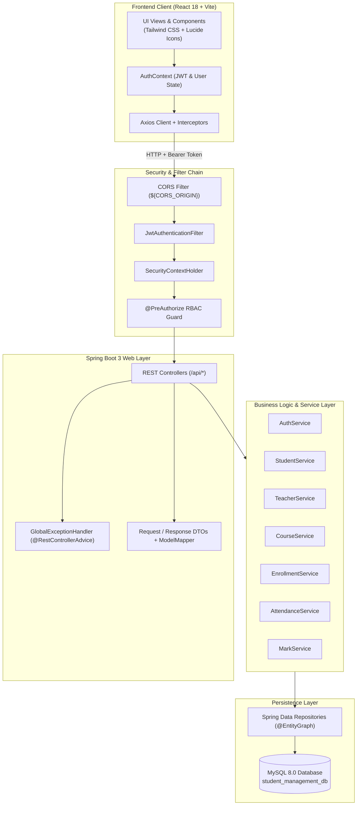
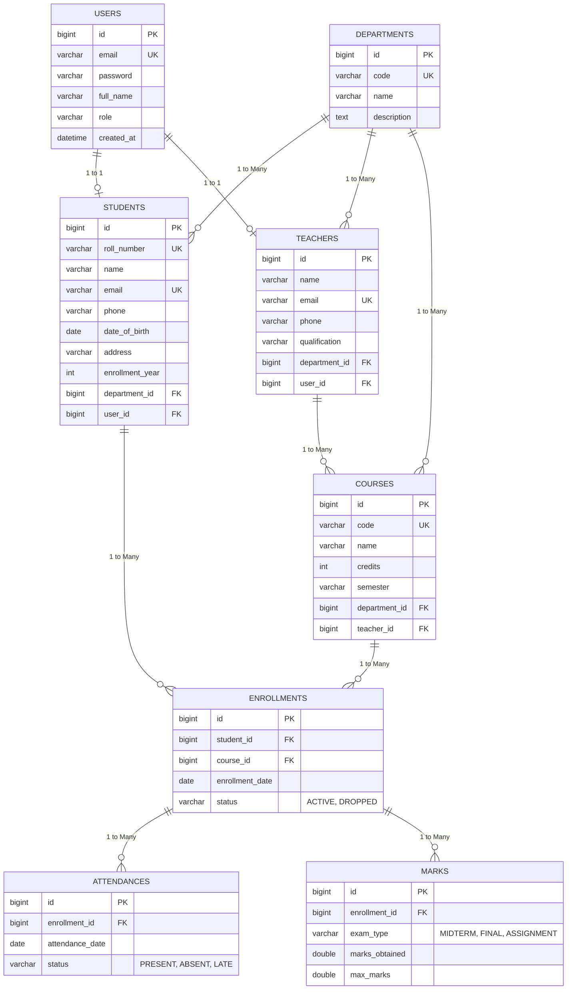

# Student Management System (SMS)

> **A production-quality, resume-ready full-stack academic management and student grading portal built with Spring Boot 3, Spring Security 6 (stateless JWT), MySQL 8, and React 18 (Vite & Tailwind CSS).**

[](https://www.oracle.com/java/)
[](https://spring.io/projects/spring-boot)
[-6DB33F?logo=springsecurity&logoColor=white)](https://spring.io/projects/spring-security)
[](https://www.mysql.com/)
[](https://react.dev/)
[](https://vitejs.dev/)
[](https://tailwindcss.com/)
[](LICENSE)

<p align="left">
  <a href="https://render.com/deploy?repo=https://github.com/harshh-1573/student-management-system" target="_blank">
    
  </a>
  &nbsp;&nbsp;
  <a href="https://vercel.com/new/clone?repository-url=https://github.com/harshh-1573/student-management-system&root-directory=frontend" target="_blank">
    
  </a>
</p>

---


## Table of Contents
1. [Overview](#overview)
2. [Key Features by Role](#key-features-by-role)
3. [Technology Stack](#technology-stack)
4. [System Architecture](#system-architecture)
5. [Database Entity-Relationship (ER) Diagram](#database-entity-relationship-er-diagram)
6. [Demo Accounts & Credentials](#demo-accounts--credentials)
7. [Prerequisites](#prerequisites)
8. [Step-by-Step Installation & Setup](#step-by-step-installation--setup)
   - [Database Setup](#1-database-setup)
   - [Backend Configuration & Execution](#2-backend-configuration--execution)
   - [Frontend Configuration & Execution](#3-frontend-configuration--execution)
9. [Complete API Endpoint Matrix](#complete-api-endpoint-matrix)
10. [Sample API Requests & Responses](#sample-api-requests--responses)
11. [Project Folder Structure](#project-folder-structure)
12. [Testing & Quality Assurance](#testing--quality-assurance)
13. [Future Enhancements](#future-enhancements)

---

## Overview

The **Student Management System (SMS)** is an enterprise-grade academic administration platform designed to replace legacy manual paper registers with an automated, responsive digital workflow. It unifies admissions, course enrollment, class roster management, daily attendance tracking, multi-assessment examination grading, and automated 10-point GPA calculation into a secure, role-guarded web interface.

### Architectural Highlights
- **Stateless JWT Security Architecture**: Built on Spring Security 6 with custom `SecurityFilterChain`, `JwtAuthenticationFilter`, BCrypt password hashing, and token validation.
- **Strict Method & Ownership Authorization**: In addition to `@PreAuthorize` role gates, service-layer ownership checks prevent Insecure Direct Object References (IDOR). Teachers can only modify their assigned classes; students can only view their own transcripts.
- **N+1 Query Optimization**: Utilizes JPA 2.2 `@EntityGraph` and explicit JPQL `JOIN FETCH` queries to eliminate Hibernate N+1 query overhead across all relations.
- **Production Seed Data**: Includes an idempotent Spring `CommandLineRunner` (`DataInitializer`) that seeds sample departments, teachers, students, courses, enrollments, attendance records, and exam scores with BCrypt passwords.
- **Rich React 18 User Experience**: Built with Vite, Tailwind CSS, Lucide icons, and Recharts, featuring one-click demo login buttons, responsive drawers, dynamic grade previews, and toast notifications.

---

## Key Features by Role

### 🛡️ System Administrator (`ROLE_ADMIN`)
- **Executive Analytics Dashboard**: High-level statistical cards (Total Students, Teachers, Courses, Departments, Active Enrollments), dynamic student distribution bar chart by department, and course capacity pie charts.
- **Department Management**: Full CRUD on academic departments (CSE, IT, ECE, MECH, etc.).
- **Teacher & Student Provisioning**: Create and update faculty and student profiles while automatically generating their linked Spring Security user credentials.
- **Course Administration**: Define course catalogs (course codes, credit hours, semesters) and assign faculty instructors.
- **Course Rosters & Enrollments**: Enroll students in courses, manage class rosters, and process drop requests.

### 👨‍🏫 Faculty / Teacher (`ROLE_TEACHER`)
- **Assigned Course Roster**: View only courses assigned to the authenticated teacher.
- **Daily Class Attendance**: Pick course and date, view class roster, toggle student presence (`PRESENT`, `ABSENT`, `LATE`), utilize quick batch actions ("All Present", "All Absent"), and persist with one click.
- **Attendance Analytics**: Inspect student attendance percentage across the entire semester with automated low-attendance warnings ($< 75\%$).
- **Examination Grade Book**: Record Midterm, Final, and Assignment marks; dynamically preview calculated percentages and letter grades before saving.

### 🎓 Student (`ROLE_STUDENT`)
- **My Profile**: View roll number, personal information, contact numbers, department, and admission year.
- **My Courses**: View all currently active course enrollments, instructor names, and credit weights.
- **My Attendance Log**: View historical daily attendance logs and real-time percentage progress bars per course.
- **Academic Transcript & GPA**: Complete grade card displaying course-wise scores, percentage, letter grades ($\text{A+}$, $\text{A}$, $\text{B}$, $\text{C}$, $\text{D}$, $\text{F}$), grade points ($10.0$ to $0.0$), and cumulative Grade Point Average (CGPA) on a 10-point scale.

---

## Technology Stack

### Backend
- **Core Platform**: Java 17 (fully compatible up to Java 25), Spring Boot 3.2.5.
- **Security**: Spring Security 6.2, JJWT (`io.jsonwebtoken:0.12.5`), BCrypt Password Encoder.
- **Persistence**: Spring Data JPA, Hibernate 6.4, MySQL Connector/J 8.3.
- **Mapping & Utilities**: ModelMapper 3.2.0 (configured with `STRICT` matching), Jakarta Validation (`jakarta.validation-api`).
- **Documentation**: SpringDoc OpenAPI 2.5 (Swagger UI 3 with Bearer JWT Authorize button).
- **Testing**: JUnit 5, Mockito, Spring Test (`@WebMvcTest`, `@SpringBootTest`).

### Frontend
- **Core Library**: React 18.3, Vite 5.2.
- **Styling**: Tailwind CSS 3.4, PostCSS, Autoprefixer.
- **Routing**: React Router DOM v6.23 (Nested Layouts, `ProtectedRoute`, `RoleRoute`).
- **HTTP Client**: Axios 1.6 (with JWT injection and 401 auto-logout interceptors).
- **Forms & Notifications**: React Hook Form 7.51, React Hot Toast 2.4.
- **Charts & Icons**: Recharts 2.12, Lucide React 0.378.

---

## System Architecture



---

## Database Entity-Relationship (ER) Diagram



---

## Demo Accounts & Credentials

The application seeds ready-to-test accounts automatically on startup via `DataInitializer`:

| Role | Name | Email | Password | Access Scope |
| :--- | :--- | :--- | :--- | :--- |
| **ADMIN** | System Administrator | `admin@sms.com` | `Admin@123` | Full access to all departments, teachers, students, courses, enrollments, attendance, and grades. |
| **TEACHER** | Alan Turing | `alan.turing@sms.com` | `Teacher@123` | Instructor for CS101, CS201, CS301. Attendance & marks for assigned courses. |
| **TEACHER** | Ada Lovelace | `ada.lovelace@sms.com` | `Teacher@123` | Instructor for CS102, IT101, EC101. Attendance & marks for assigned courses. |
| **STUDENT** | John Doe | `john.doe@sms.com` | `Student@123` | Student Roll: `CS2024001` (Dept: CSE). Personal portal, courses, attendance, transcript. |
| **STUDENT** | Jane Smith | `jane.smith@sms.com` | `Student@123` | Student Roll: `CS2024002` (Dept: CSE). |
| **STUDENT** | Alice Johnson | `alice.johnson@sms.com` | `Student@123` | Student Roll: `IT2024001` (Dept: IT). |
| **STUDENT** | Bob Brown | `bob.brown@sms.com` | `Student@123` | Student Roll: `EC2024001` (Dept: ECE). |
| **STUDENT** | Charlie Davis | `charlie.davis@sms.com` | `Student@123` | Student Roll: `CS2024003` (Dept: CSE). |

> **Tip**: The login page includes convenient **1-Click Quick Demo Login** buttons for Instant Admin, Teacher, and Student access.

---

## Prerequisites

- **Java JDK**: 17, 21, or 25 installed and available on `PATH` (`java -version`).
- **Apache Maven**: 3.8+ installed (`mvn -version`).
- **Node.js & npm**: Node.js 18.0+ and npm 9.0+ (`node -v`, `npm -v`).
- **MySQL Server**: 8.0+ running on `localhost:3306`.

---

## Step-by-Step Installation & Setup

### 1. Database Setup

Ensure MySQL is running on port 3306. You can create the database manually or let Spring Boot automatically create it:

```sql
CREATE DATABASE IF NOT EXISTS student_management_db;
```

*(The backend's JDBC connection URL includes `createDatabaseIfNotExist=true`)*.

---

### 2. Backend Configuration & Execution

#### A. Configure Environment Variables
Copy `backend/.env.example` to `backend/.env` (or configure system environment variables):

```bash
cd backend
cp .env.example .env
```

Set your values in `backend/.env`:
```env
# Database Credentials
DB_URL=jdbc:mysql://localhost:3306/student_management_db?createDatabaseIfNotExist=true&useSSL=false&serverTimezone=UTC&allowPublicKeyRetrieval=true
DB_USERNAME=root
DB_PASSWORD=your_mysql_password_here

# JWT Secret (Must be at least 256 bits / 32 characters)
JWT_SECRET=404E635266556A586E3272357538782F413F4428472B4B6250645367566B5970
JWT_EXPIRATION_MS=86400000

# CORS Allowed Origin
CORS_ORIGIN=http://localhost:5173
```

#### B. Build & Run Tests
Execute the Maven build from the `backend/` directory:

```bash
mvn clean test
```
All 22 unit and controller tests will run and pass.

#### C. Start the Spring Boot Server
```bash
mvn spring-boot:run
```

The backend server starts on **`http://localhost:8080`**.
- **Swagger UI Interactive Docs**: `http://localhost:8080/swagger-ui/index.html`
- **OpenAPI 3 JSON Spec**: `http://localhost:8080/v3/api-docs`

---

### 3. Frontend Configuration & Execution

#### A. Configure Frontend Environment
In a new terminal window:

```bash
cd frontend
cp .env.example .env
```

Ensure `frontend/.env` points to the Spring Boot API:
```env
VITE_API_URL=http://localhost:8080/api
```

#### B. Install Dependencies & Build
```bash
npm install
npm run build
```

#### C. Launch the Development Server
```bash
npm run dev
```

Open your browser to: **`http://localhost:5173`**.

---

## Complete API Endpoint Matrix

| Method | Endpoint | Allowed Roles | Description |
| :--- | :--- | :--- | :--- |
| **POST** | `/api/auth/register` | Public | Register a new user account |
| **POST** | `/api/auth/login` | Public | Authenticate and obtain JWT Bearer token |
| **GET** | `/api/auth/me` | Authenticated | Retrieve current user profile and role |
| **GET** | `/api/departments` | ADMIN, TEACHER | Paginated list of departments with search |
| **GET** | `/api/departments/all` | ADMIN, TEACHER | Complete unpaginated department list |
| **GET** | `/api/departments/{id}` | ADMIN, TEACHER | Get department details by ID |
| **POST** | `/api/departments` | ADMIN | Create a new department |
| **PUT** | `/api/departments/{id}` | ADMIN | Update an existing department |
| **DELETE** | `/api/departments/{id}` | ADMIN | Remove department |
| **GET** | `/api/teachers` | ADMIN | Paginated list of teachers with search |
| **GET** | `/api/teachers/all` | ADMIN | Complete unpaginated teacher list |
| **GET** | `/api/teachers/{id}` | ADMIN, TEACHER | Get teacher details by ID |
| **POST** | `/api/teachers` | ADMIN | Create teacher profile and login user |
| **PUT** | `/api/teachers/{id}` | ADMIN | Update teacher profile |
| **DELETE** | `/api/teachers/{id}` | ADMIN | Delete teacher profile |
| **GET** | `/api/students` | ADMIN, TEACHER | Paginated list of students with search |
| **GET** | `/api/students/all` | ADMIN, TEACHER | Complete unpaginated student list |
| **GET** | `/api/students/{id}` | ADMIN, TEACHER | Get student details by ID |
| **GET** | `/api/students/me` | STUDENT | Get current authenticated student profile |
| **GET** | `/api/students/{id}/report` | ADMIN, TEACHER | Get full academic transcript & GPA report |
| **GET** | `/api/students/me/report` | STUDENT | Get self academic transcript & GPA report |
| **POST** | `/api/students` | ADMIN | Create student profile and login user |
| **PUT** | `/api/students/{id}` | ADMIN | Update student profile |
| **DELETE** | `/api/students/{id}` | ADMIN | Delete student profile |
| **GET** | `/api/courses` | ADMIN, TEACHER, STUDENT | Paginated courses list with search |
| **GET** | `/api/courses/all` | ADMIN, TEACHER, STUDENT | Complete unpaginated course list |
| **GET** | `/api/courses/{id}` | ADMIN, TEACHER, STUDENT | Get course details by ID |
| **POST** | `/api/courses` | ADMIN | Create new course catalog entry |
| **PUT** | `/api/courses/{id}` | ADMIN | Update course details |
| **DELETE** | `/api/courses/{id}` | ADMIN | Delete course |
| **POST** | `/api/enrollments` | ADMIN, STUDENT | Enroll a student in a course |
| **DELETE** | `/api/enrollments/{id}` | ADMIN, STUDENT | Drop enrollment (status $\to$ `DROPPED`) |
| **GET** | `/api/enrollments/course/{id}` | ADMIN, TEACHER | Get class roster for course |
| **GET** | `/api/enrollments/student/{id}` | ADMIN, TEACHER, STUDENT | Get course enrollments for a student |
| **GET** | `/api/enrollments/my-enrollments`| STUDENT | Get logged-in student's active courses |
| **POST** | `/api/attendance/batch` | ADMIN, TEACHER | Save batch daily attendance for course |
| **GET** | `/api/attendance/course/{id}` | ADMIN, TEACHER | Get attendance records by course & date |
| **GET** | `/api/attendance/course/{id}/stats` | ADMIN, TEACHER | Get aggregated student attendance % |
| **GET** | `/api/attendance/my-attendance`| STUDENT | Get logged-in student's attendance log |
| **POST** | `/api/marks` | ADMIN, TEACHER | Record individual exam marks |
| **POST** | `/api/marks/batch` | ADMIN, TEACHER | Save batch marks for course & exam type |
| **GET** | `/api/marks/course/{id}` | ADMIN, TEACHER | Get recorded marks for course |
| **GET** | `/api/marks/enrollment/{id}` | ADMIN, TEACHER, STUDENT | Get marks for enrollment ID |
| **GET** | `/api/marks/my-marks` | STUDENT | Get logged-in student's examination marks |
| **GET** | `/api/dashboard/stats` | ADMIN, TEACHER | Summary statistics and charts data |

---

## Sample API Requests & Responses

### 1. User Authentication (`POST /api/auth/login`)
```bash
curl -X POST http://localhost:8080/api/auth/login \
  -H "Content-Type: application/json" \
  -d '{
    "email": "admin@sms.com",
    "password": "Admin@123"
  }'
```

**Response (`200 OK`):**
```json
{
  "success": true,
  "message": "Login successful",
  "data": {
    "token": "eyJhbGciOiJIUzI1NiJ9...",
    "type": "Bearer",
    "id": 1,
    "email": "admin@sms.com",
    "fullName": "System Administrator",
    "role": "ROLE_ADMIN"
  },
  "timestamp": "2026-10-12T13:45:00"
}
```

---

### 2. Batch Attendance Recording (`POST /api/attendance/batch`)
```bash
curl -X POST http://localhost:8080/api/attendance/batch \
  -H "Content-Type: application/json" \
  -H "Authorization: Bearer <TOKEN>" \
  -d '{
    "courseId": 1,
    "date": "2026-10-12",
    "records": [
      { "studentId": 1, "status": "PRESENT" },
      { "studentId": 2, "status": "LATE" },
      { "studentId": 5, "status": "ABSENT" }
    ]
  }'
```

---

### 3. Student Academic Transcript (`GET /api/students/me/report`)
```bash
curl -X GET http://localhost:8080/api/students/me/report \
  -H "Authorization: Bearer <STUDENT_TOKEN>"
```

**Response (`200 OK`):**
```json
{
  "success": true,
  "message": "Operation successful",
  "data": {
    "student": {
      "id": 1,
      "rollNumber": "CS2024001",
      "name": "John Doe",
      "email": "john.doe@sms.com",
      "departmentName": "Computer Science & Engineering"
    },
    "totalEnrolledCourses": 3,
    "totalCredits": 11,
    "cumulativeGpa": 9.27,
    "courses": [
      {
        "courseId": 1,
        "courseCode": "CS101",
        "courseName": "Data Structures & Algorithms",
        "credits": 4,
        "attendancePercentage": 95.0,
        "totalMarksObtained": 88.0,
        "totalMaxMarks": 100.0,
        "overallPercentage": 88.0,
        "grade": "A",
        "gradePoint": 9.0
      }
    ]
  },
  "timestamp": "2026-10-12T13:45:00"
}
```

---

## Project Folder Structure

```
student-management-system/
├── backend/                                   # Spring Boot 3 + Maven Backend
│   ├── postman/
│   │   └── StudentManagementSystem.postman_collection.json # Ready-to-import Postman collection
│   ├── src/
│   │   ├── main/
│   │   │   ├── java/com/student/management/
│   │   │   │   ├── config/                    # SecurityConfig, ModelMapperConfig, SwaggerConfig
│   │   │   │   ├── controller/                # 9 REST Controllers (Auth, Student, Teacher, Course, etc.)
│   │   │   │   ├── dto/                       # Request & Response DTOs, ApiResponse, PageResponse
│   │   │   │   ├── entity/                    # 8 JPA Entities (User, Student, Course, Enrollment, etc.)
│   │   │   │   ├── exception/                 # Custom exceptions & GlobalExceptionHandler
│   │   │   │   ├── repository/                # 9 Spring Data JPA Repositories (@EntityGraph)
│   │   │   │   ├── security/                  # JwtTokenProvider, JwtAuthFilter, UserPrincipal
│   │   │   │   ├── service/                   # Service Interfaces & Implementations
│   │   │   │   └── util/                      # Enums (RoleType, ExamType, AttendanceStatus), Constants
│   │   │   └── resources/
│   │   │       └── application.properties     # Production properties (no hardcoded credentials)
│   │   └── test/                              # 22 JUnit 5, Mockito & @WebMvcTest suites
│   ├── .env.example                           # Backend environment template
│   └── pom.xml                                # Maven build descriptor
│
├── frontend/                                  # React 18 + Vite Frontend
│   ├── src/
│   │   ├── api/                               # Axios instance & modular API client modules
│   │   ├── components/
│   │   │   ├── common/                        # DataTable, Modal, ConfirmDialog, StatCard, Loader, etc.
│   │   │   ├── layout/                        # AppLayout, Navbar, Sidebar
│   │   │   └── routes/                        # ProtectedRoute, RoleRoute
│   │   ├── context/                           # AuthContext (JWT storage & session management)
│   │   ├── pages/                             # 12 Page Views:
│   │   │   ├── auth/                          # Login, Register
│   │   │   ├── dashboard/                     # AdminDashboard (Recharts Bar & Pie charts)
│   │   │   ├── departments/                   # DepartmentsPage (CRUD)
│   │   │   ├── teachers/                      # TeachersPage (CRUD)
│   │   │   ├── students/                      # StudentsPage (CRUD) & StudentDetailPage (Full Report)
│   │   │   ├── courses/                       # CoursesPage (CRUD & Enrolled Student Modal)
│   │   │   ├── enrollments/                   # EnrollmentPage (Enroll / Drop)
│   │   │   ├── attendance/                    # AttendancePage (Register & Course Stats)
│   │   │   ├── marks/                         # MarksPage (Gradebook & Letter Grade Previews)
│   │   │   ├── student-portal/                # StudentPortal (Profile, Courses, Attendance, GPA)
│   │   │   └── NotFound.jsx                   # 404 Error Page
│   │   ├── App.jsx                            # React Router v6 tree with role guards
│   │   ├── main.jsx                           # Application entry point
│   │   └── index.css                          # Tailwind CSS direct imports
│   ├── .env.example                           # Frontend environment template
│   ├── package.json                           # NPM dependencies
│   ├── tailwind.config.js                     # Tailwind configuration
│   └── vite.config.js                         # Vite build configuration
│
├── README.md                                  # Root documentation (this document)
└── RESUME_AND_INTERVIEW.md                    # Resume bullets, LaTeX lines, & 25 Interview Q&As
```

---

## Testing & Quality Assurance

### Backend Automated Test Suite
The backend contains **22 automated tests** covering service business logic, security authentication, and controller endpoints:

```bash
cd backend
mvn test
```

- **`AuthServiceTest`** (4 tests): Registration, duplicate user rejection, login success, invalid password rejection.
- **`StudentServiceTest`** (4 tests): Student creation, duplicate roll number validation, pagination retrieval, student deletion.
- **`EnrollmentServiceTest`** (4 tests): Course enrollment, duplicate enrollment rejection, course drop, student ownership validation.
- **`AttendanceServiceTest`** (4 tests): Batch attendance marking, teacher course ownership enforcement, attendance stats computation, student attendance retrieval.
- **`AuthControllerTest`** (2 tests): `@WebMvcTest` controller slice tests for login and register.
- **`DepartmentControllerTest`** (2 tests): `@WebMvcTest` controller slice tests for department creation and retrieval.
- **`CourseControllerTest`** (2 tests): `@WebMvcTest` controller slice tests for course creation and retrieval.

### Postman API Collection
Import the collection located at:
[`backend/postman/StudentManagementSystem.postman_collection.json`](file:///d:/01_PROJECTS/STUDENT-MANAGEMENT/backend/postman/StudentManagementSystem.postman_collection.json)

The collection includes a pre-configured `token` environment variable automatically set upon logging in via the `Login (Admin)` request.

---

## Future Enhancements

1. **Docker & Container Orchestration**: Add a root `docker-compose.yml` for multi-stage building and running backend, frontend, and MySQL containers with single-command startup.
2. **Flyway / Liquibase**: Version-controlled, reproducible database migrations across environments.
3. **Redis Caching**: Cache department lists and course catalogs using Spring Cache (`@Cacheable`) with TTL expiration.
4. **Email Notification Engine**: Automated emails on enrollment confirmation or when attendance drops below $75\%$ using Spring Mail and Thymeleaf templates.
5. **PDF Transcript Export**: One-click download of official academic transcripts generated using iText / OpenPDF.
